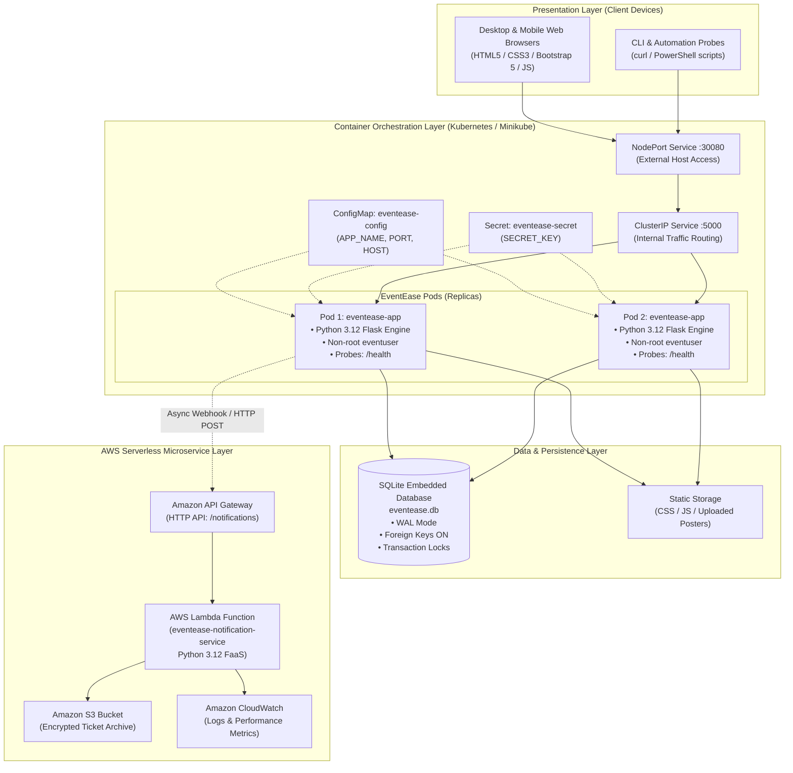
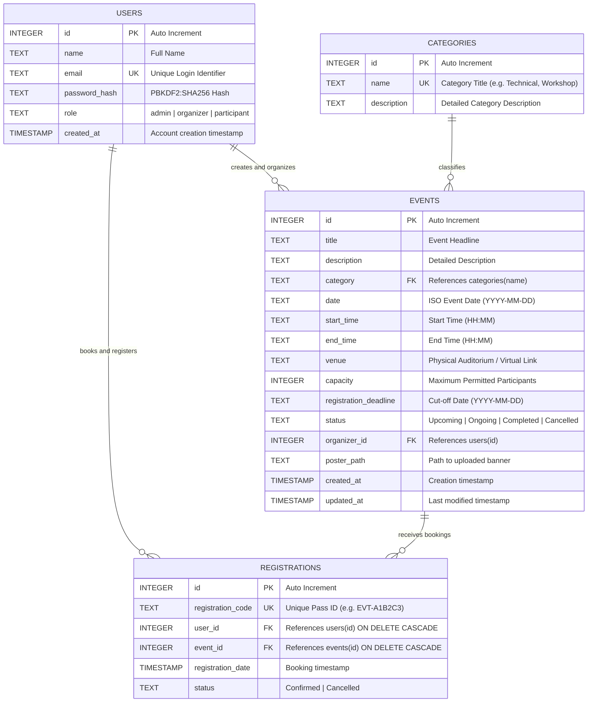
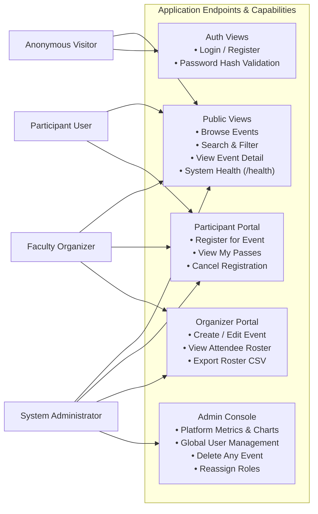

# EventEase — System Architecture & Design Document

Part of the **BCA Cloud Computing and Virtualization** microproject portfolio.

---

## 1. High-Level System Architecture

EventEase is built following a modular, multi-tier cloud-native architecture combining a **monolithic core application (Flask)**, a **relational datastore (SQLite)**, **container orchestration (Kubernetes & Docker)**, and an **event-driven serverless microservice (AWS Lambda & API Gateway)**.



---

## 2. Database Entity-Relationship (ER) Diagram

The datastore enforces relational integrity, foreign key constraints, cascading deletions, and uniqueness rules.



---

## 3. Concurrency-Safe Event Registration Sequence

To prevent race conditions, overselling seats, and duplicate bookings, registration utilizes database-level transactions with immediate exclusive table locks (`BEGIN IMMEDIATE`).

```mermaid
sequenceDiagram
    autonumber
    actor Participant as Student / Participant
    participant App as Flask Web Server
    participant DB as SQLite Relational Database

    Participant->>App: POST /events/{id}/register (Session Auth Cookie)
    App->>App: Verify Authentication (@login_required)
    
    App->>DB: BEGIN IMMEDIATE (Acquire Write Lock)
    App->>DB: SELECT * FROM events WHERE id = ?
    DB-->>App: Return Event Details
    
    alt Event Not Found or Not 'Upcoming'
        App->>DB: ROLLBACK
        App-->>Participant: 400 Bad Request / Flash Warning
    else Registration Deadline Passed
        App->>DB: ROLLBACK
        App-->>Participant: Error: Deadline Expired
    end

    App->>DB: SELECT id, status FROM registrations WHERE user_id = ? AND event_id = ?
    DB-->>App: Existing Registration Status

    alt Already Confirmed
        App->>DB: ROLLBACK
        App-->>Participant: Info: Already Registered for this event
    end

    App->>DB: SELECT COUNT(*) FROM registrations WHERE event_id = ? AND status = 'Confirmed'
    DB-->>App: Confirmed Count

    alt Confirmed Count >= Capacity
        App->>DB: ROLLBACK
        App-->>Participant: Error: Event Capacity Reached (Overbooking Blocked)
    else Seats Available
        App->>App: Generate Unique Code (EVT-XXXXXX)
        App->>DB: INSERT INTO registrations (registration_code, user_id, event_id, status)
        App->>DB: COMMIT (Release Write Lock)
        App-->>Participant: 302 Redirect -> /registrations/success/{code}
    end
```

---

## 4. Role-Based Access Control (RBAC) Architecture



---

## 5. Serverless Microservice Integration Pattern

The serverless component runs decoupled from the core application:
1. **Event Notification**: Broadcasters send JSON events containing event title, date, and recipient email addresses to Amazon API Gateway.
2. **Lambda Ingestion**: The `eventease-notification-service` Lambda function validates the schema and authorization.
3. **Cryptographic Verification**: Generates a verifiable SHA-256 digital signature for digital passes.
4. **CloudWatch Metrics**: Automatically logs invocation duration, cold starts, and errors with zero manual agent configuration.
